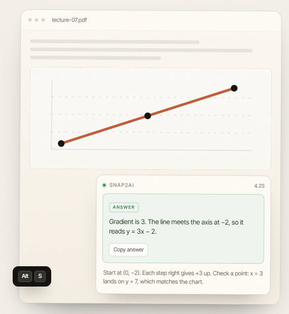

<div align="center">

# Snap2AI

**Screenshot it. Understand it.**

A Chrome and Brave extension that sends your screen to the AI you already use and puts the answer in a panel over the page. No new account, no API key, no copy-paste.

[](https://github.com/blame-me/snap2ai/releases/latest)
[](https://snap2ai-site.vercel.app)
[](https://developer.chrome.com/docs/extensions/develop/migrate/what-is-mv3)
[](https://github.com/blame-me/snap2ai/releases/latest/download/snap2ai.zip)

[Download](https://github.com/blame-me/snap2ai/releases/latest/download/snap2ai.zip) · [Website](https://snap2ai-site.vercel.app) · [Install guide](https://snap2ai-site.vercel.app/#install) · [Fixes](https://snap2ai-site.vercel.app/#fixes)

</div>



## What it does

You are stuck on something you can see: a stack trace, a slide, a chart, a Netmath problem, a form in a language you don't read. Typing all of it back into a chat window is the slow part.

Snap2AI removes that part.

1. Press **Alt+S** on the page.
2. It captures the visible screen and opens your chosen AI in a background tab.
3. The screenshot and prompt are pasted and sent for you.
4. The answer appears in a panel on the page you were already looking at.

The panel shows a short answer first, the reasoning underneath, and a copy button. **Esc** closes it and cancels anything still running.

## Supported AI sites

Gemini · ChatGPT · Claude · Grok · Copilot · Perplexity · DeepSeek · Mistral

It uses the session you already have in the browser. Snap2AI never asks for a login, an API key or a subscription. Whatever plan and history you have with that AI stays yours.

## Features

| | |
|---|---|
| **One shortcut** | `Alt+S` from any normal page. Rebindable at `chrome://extensions/shortcuts`. |
| **Your AI, your session** | Drives the real web app in a background tab. No API keys, no proxy. |
| **Backup AI** | If the first provider fails, the same screenshot goes to a second one automatically. |
| **Fresh chat** | Starts a clean conversation per capture when you want no context bleed. |
| **Auto-copy** | Puts the short answer on your clipboard as soon as it arrives. |
| **History** | Keeps your recent answers locally. Nothing leaves the machine except the screenshot you asked to send. |
| **No telemetry** | No analytics, no account, no server of ours. |

## Install

Snap2AI is not on the Web Store yet, so this is the unpacked route. It takes about a minute.

1. **Download the zip** from [Releases](https://github.com/blame-me/snap2ai/releases/latest) and unzip it.
2. Open `chrome://extensions` (or `brave://extensions`, `edge://extensions`).
3. Turn on **Developer mode**.
4. Click **Load unpacked** and select the `snap2ai` folder, the one containing `manifest.json`.
5. Open `chrome://extensions/shortcuts` and bind **Alt+S** to "Screenshot the screen and get the answer".
6. Sign in to at least one AI site in the same browser profile.

**Updating:** replace the folder contents, click the reload arrow on the Snap2AI card, then refresh the pages you had open. Old content scripts stay injected until you do.

## Use

Press `Alt+S`, or click the toolbar icon and choose **Capture screen**.

The icon popup also has the ON/OFF switch, the AI picker, a manual capture button and your recent answers. Settings cover the prompt, fresh chat, auto-copy and whether to show the AI tab while it works.

## Troubleshooting

The most common ones, with fixes:

| Symptom | Usually |
|---|---|
| `Alt+S` does nothing | Another app owns the shortcut, or you are on a `chrome://` page where extensions can't run |
| "You're not logged in" | The AI site is signed out in this browser profile |
| Stuck on "verify you're human" | Solve the check once in the AI tab, then retry |
| Panel spins forever | Kill it with Esc, clear whatever is blocking the AI tab, or set a Backup AI |
| Nothing changed after an update | Reload the extension on the extensions page, then refresh your tabs |

All eight fixes live at **[snap2ai-site.vercel.app/#fixes](https://snap2ai-site.vercel.app/#fixes)**.

Still stuck? [Open an issue](https://github.com/blame-me/snap2ai/issues/new) with your browser, the AI site, and the last thing the panel said.

## Permissions

Snap2AI asks for the minimum it needs to do the job, and nothing runs until you trigger a capture.

| Permission | Why |
|---|---|
| `activeTab` | Read the current tab after you press the shortcut or click capture. |
| `tabs` | Open the AI site in a background tab and bring it forward when asked. |
| `scripting` | Inject the panel and the small helper scripts into the AI tab. |
| `storage` | Sync your settings and keep the answer history local. |
| Host access | The eight AI sites only. No `<all_urls>`. |

## Privacy

The screenshot goes to the AI site you selected and nowhere else. There is no Snap2AI backend, no analytics and no account. Answer history is stored in `chrome.storage.local` and can be cleared from the popup.

## Under the hood

No build step, no dependencies. Plain ES2020 and MV3.

```
manifest.json      extension manifest
background.js      service worker: capture, tab orchestration, per-site automation
shared.js          provider list, defaults, answer parser, mini markdown renderer
panel.js / ui.css  the in-page answer panel
popup.html/js      toolbar popup
options.html/js    settings and about
icons/             toolbar icons
docs/preview.png   the image at the top of this README
```

`background.js` drives the flow and injects self-contained functions into the AI tab (`aiPaste`, `aiSend`, `aiRead`...). Each provider has its own selectors. When a site changes its DOM, that provider's block is usually the only thing to update.

## Development

```bash
git clone https://github.com/blame-me/snap2ai.git
cd snap2ai
```

Load the folder with **Load unpacked**, make your change, then hit the reload arrow on the extension card and refresh the test page. There is no compiler and no `npm install`.

## Version history

- **5.5** Faster default prompt, lighter screenshot upload, shorter waits, finishes sooner.
- **5.4** About page in Settings with the certificate of authenticity and the project links.
- **5.3** Fixed echoed instructions, faster send detection, fixed stuck Stop buttons, faster login-wall detection.
- **5.2** Gemini status text ignored, Backup AI, clearer auth errors, attach retries, elapsed time, Esc to cancel.

Full notes: [Releases](https://github.com/blame-me/snap2ai/releases).

## Contributing

Issues and pull requests are welcome. If a provider stops working, open an issue with the site, your browser version, and a screenshot of the panel. If you are changing selectors, test both the normal and "not logged in" states.

## Credits

Built by Eden ([@blame-me](https://github.com/blame-me)).

Not affiliated with Google, Anthropic, OpenAI, Microsoft, Perplexity, DeepSeek or Mistral. All product names belong to their owners.
